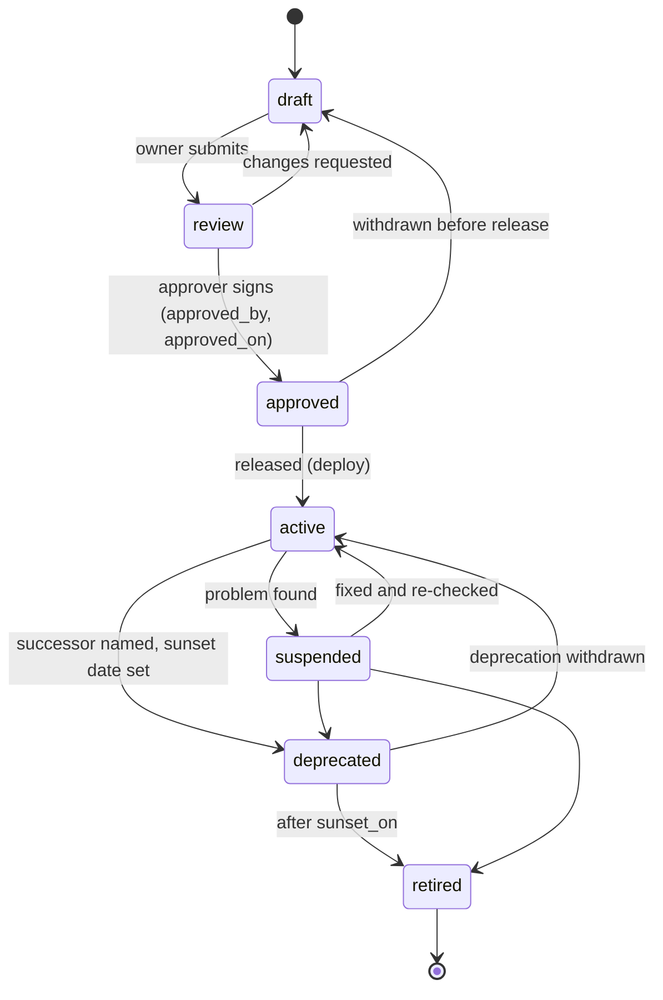

# NEXA-M3-001: NEXA Agent Contract and Lifecycle

Status: proposed for approval (2026-11-18). Owner: Yasaru. Approver: Mr. Chandana.
Contract version: **nexa.agent/1.0**. Builds on NEXA-ADR-0003 (Agent Runtime), ADR-0005 (identity and RBAC),
ADR-0006 (Tool Gateway, proposed) and the M2 Knowledge Service.

## 1. Purpose

Every NEXA agent, whoever builds it, implements one contract: a manifest file that says what the agent is,
what it may do and touch, what it runs on, how it fails, and where it is in its life. The Agent Runtime
loads only agents whose manifests pass validation and enforces what they declare. Reviewers approve a
manifest, and its fingerprint proves that what runs is what they approved.

## 2. The manifest

One JSON file per agent in `v1/agent_runtime/agents/<id>.json`. Machine-readable schema:
`v1/agent_runtime/schema/nexa-agent-manifest-1.0.schema.json` (JSON Schema 2020-12, generated from the
contract and checked in CI to stay identical). Code: `v1/agent_runtime/manifest.py`.

| Section | Declares | Enforced by |
|---|---|---|
| `identity` | `id` (`nexa-…`, never reused), `name`, `version` (semantic), `owner`, `description` | schema; file name must be `<id>.json`; ids unique |
| `purpose` | `summary`, `audience` (student, teacher, school_admin, national_admin, service), `in_scope`, `out_of_scope` | schema; audience drives the safety and data rules below |
| `capabilities` | from a controlled vocabulary: chat, curriculum_answer, general_answer, explanation, calculation, lesson_planning, assessment_generation, summarisation, translation, course_outline | schema; `curriculum_answer` requires citations in the output |
| `interface` | input and output envelopes (`nexa.run.request/1`, `nexa.run.response/1`), course context, message limit, citations | schema; the runtime's RunRequest/RunResponse |
| `permissions` | `run_permission`, `allowed_roles`, knowledge `access_classes` (learner, teacher_only, restricted) and `scopes` | platform rules (permission and roles exist, each role holds the permission); **runtime**: caller must hold the permission **and** one of the roles |
| `tools` | each tool: name, purpose, permission, `max_calls_per_run` | platform rules (tool registered, permission matches the tool's, a runnable agent only gets tools that are built); **runtime**: `invoke_tool` checks declaration, permission and availability, and audits |
| `model` | logical Model Gateway model, `fallbacks`, temperature, max output tokens, min context | platform rules (models exist in the gateway); **runtime**: temperature and token limit applied, fallbacks used when the model stays unavailable |
| `memory` | `conversation` (none or request), `long_term` (none, read, read_write), scopes, retention | schema and platform rules (long-term memory needs the Memory Service; no student agent writes long-term memory in 1.0) |
| `safety` | `policy` (nexa.safety.student/1, teacher/1, service/1), `serves_minors`, citations, general answers labelled, `refuse` list, no PII in prompts, `escalation` | platform rules (policy exists; a student agent runs under the student policy, serves minors, reads learner content only) |
| `runtime` | `timeout_s` for the whole run, `retry` (attempts, backoff, retry_on: gateway_unavailable, timeout), concurrency | **runtime**: whole-run deadline (504), retries only for the listed kinds, never for a real error |
| `health` | services the agent needs: model_gateway, knowledge_service, tool_registry, memory_service | schema and platform rules (tools need the tool registry, knowledge access the Knowledge Service, memory the Memory Service) |
| `lifecycle` | `state`, approval record, deprecation and sunset dates, successor, `changelog` | schema (record complete for the state; first changelog entry is the current version); **runtime**: only runnable states run |
| `prompt` | the system prompt | runtime prepends it; a caller cannot send a system message |

## 3. Lifecycle



| State | Runs? | Response when called |
|---|---|---|
| draft, review, approved | no | 409 "not active (state: …)" |
| active | yes | normal |
| suspended | no | 423 "suspended" |
| deprecated | yes, until `sunset_on` | normal, with `x_nexa.deprecation` (dates, successor) |
| retired, or deprecated past `sunset_on` | no | 410, naming the successor |

Transitions outside the diagram are refused (`can_transition`). An agent never goes from draft or review
straight to active, and a retired id is never reused.

## 4. Versioning

- **Agent version** (`identity.version`, semantic): PATCH for wording and prompt fixes that do not change
  behaviour or permissions; MINOR for new capabilities or tools within the same audience and data access;
  MAJOR for any change to audience, roles, data access, safety policy or interface. Any MINOR or MAJOR
  change goes back through review and approval; every change adds a changelog entry.
- **Contract version** (`manifest_version`): 1.x adds optional fields or vocabulary only, so every 1.0
  manifest stays valid; a change that would invalidate existing manifests is 2.0, and the runtime accepts
  both until every manifest has moved.
- **Fingerprint**: sha256 of the canonical manifest, returned on every run (`x_nexa.manifest`) and by
  `GET /v1/agents/{id}/manifest`, so an audit can prove which approved manifest served a request.

## 5. Validation

1. **Structure** (pydantic, the same rules as the JSON Schema): required sections, types, ranges,
   vocabularies, no unknown fields, semantic versions, lifecycle record complete for the state.
2. **Platform rules** (`validate_platform`): models exist in the Model Gateway, roles and permissions exist
   in NEXA identity and each allowed role holds the run permission, tools are registered with the same
   permission, a runnable agent only gets built tools, safety policy exists and fits the audience, data
   access fits the audience, health covers the services used, successor exists.
3. **At load**: the runtime refuses to start if any manifest fails, so no unvalidated agent is served.
4. **In CI**: every pull request validates all manifests and checks the published schema matches the
   contract (step "Agent manifests (NEXA-M3-001)"), plus 36 tests of the contract and its enforcement.

```bash
python -m v1.agent_runtime.manifest validate                 # all manifests
python -m v1.agent_runtime.manifest validate path/to/new.json
python -m v1.agent_runtime.manifest schema                   # the JSON Schema
```

## 6. Example agents (validated 2026-11-18)

| Agent | Audience | State | Shows |
|---|---|---|---|
| `nexa-tutor` 1.0.0 | students, teachers | active | the running M1 tutor, moved into a manifest unchanged |
| `nexa-precise` 1.0.0 | students, teachers | active | the running M1 precise agent, a second model and generation settings |
| `nexa-curriculum-tutor` 0.1.0 | students | review | tools (`knowledge_answer`), learner-only knowledge, course context, citations, retry on timeout, fallback model, student safety policy |
| `nexa-lesson-planner` 0.1.0 | teachers | draft | teacher-only knowledge access, two tools, teacher safety policy, roles that exclude students |

The two new agents cannot run until the tools they use are built (Tool Gateway, later in M3): the contract
lets them be written and reviewed now, and refuses to activate them before then.

The two active agents have no separate approval record from M1 (NEXA-M1-010 is a draft for governance).
Their manifests record the M1 baseline as the approval source; approving this contract confirms them.

## 7. Adding an agent

1. Copy the closest example to `v1/agent_runtime/agents/<new-id>.json`, state `draft`, version `0.1.0`.
2. Fill every section; run `python -m v1.agent_runtime.manifest validate` until it passes.
3. Open a pull request (CI validates it); set state `review` when it is ready.
4. The approver reviews the manifest (not the code) and records `approved_by` and `approved_on`; state
   `approved`.
5. Set `active` in the release that deploys it.

## 8. Not in nexa.agent/1.0 (later in M3)

- The Tool Gateway that implements `knowledge_answer` and `course_outline` (ADR-0006).
- The Memory Service behind `memory.long_term`.
- A Safety service that owns the safety policies (defined in `manifest.py` until then) and checks outputs.
- Per-agent concurrency limits (`runtime.max_concurrent_runs` is declared; the runtime does not yet limit it).
- Recording lifecycle transitions as an audited history (today: the changelog and git history).

## 9. Acceptance (NEXA-M3-001)

| Criterion | Evidence |
|---|---|
| A standard contract covering identity, purpose, capabilities, inputs/outputs, permissions, tools, model requirements, memory/state access, safety policy, version, health, timeout/retry and lifecycle states | Section 2; `manifest.py`; the JSON Schema |
| Versioned agent manifest/schema | `manifest_version: nexa.agent/1.0`; published schema; versioning rules, section 4 |
| Approved | Pending: this document and the schema, for Mr. Chandana's approval |
| Validated with at least two example agents | Four manifests validate (section 6), in CI on every pull request; 36 tests |
