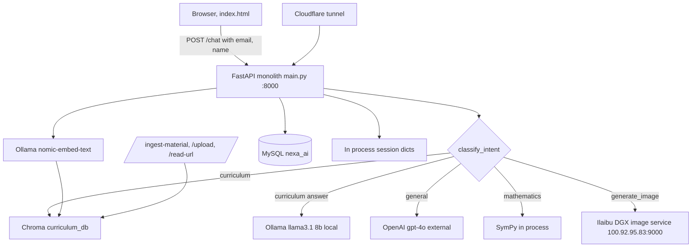

# NEXA-M0-002: Verified As-Built Architecture of NEXA v0

Status: Verified against code on branch nexa-v1-core (v0 files at repo root)
Milestone: M0
Evidence base: main.py (5599 lines), index.html, requirements.txt, nexa_mysql_setup.sql

## 1. Scope and method

This is the as-built architecture of the running NEXA v0 system, read from the
source in this repository, not from prior documentation. Line references point
at main.py. Each component is marked IMPLEMENTED (present and running) or
PLANNED (named in code or docs but not built). Trust boundaries and external
dependencies are listed in sections 5 and 6.

## 2. Request flow (implemented)

1. A browser loads the single page frontend index.html, served by `GET /`
   (main.py:4203).
2. The page calls `POST /chat` (main.py:5016) with a JSON body carrying the
   message, the user email, the user name, a session id, and the page url.
3. Role resolution: `infer_access_role(user_email)` (main.py:4625, 5020) maps
   the email domain to a role. `stu.edunex.edu.pg` is student; `edunex.edu.pg`
   is teacher or staff (main.py:3632 to 3636). There is no authentication: the
   email and name arrive in the request body and are trusted as sent.
4. Intent classification: `classify_intent(message, ...)` (main.py:856) returns
   one of generate_image, curriculum, general, smalltalk, other (main.py:921).
   Image intent is further checked by `looks_like_image_generation_request`
   (main.py:2707) and `analyze_image_text_intent` (main.py:2564).
5. Routing by intent:
   - curriculum: retrieval over the Chroma curriculum_db collection, then an
     answer composed by the local model with the retrieved context and the role
     instruction.
   - general: the OpenAI gpt-4o path (main.py:180) for general knowledge.
   - mathematics: the SymPy engine (section 3) handles symbolic work.
   - generate_image: a prompt is built and sent to the remote image service
     (section 3).
   - smalltalk and other: short local model replies and a small FAQ map
     (nexa_faq_answer, main.py:3215, 5358).
6. Session memory is hydrated and the turn recorded (main.py:5033 onward).
   The response, any image reference and the log id are returned and also
   written to MySQL chat logs.

## 3. Component map

### API and frontend (implemented)
- One FastAPI app, `app = FastAPI()` at main.py:4169, about twenty routes in a
  single module.
- Routes include `/` , `/chat`, `/upload`, `/read-url`, `/ingest-material`,
  `/chat-status`, `/api/chat-log`, `/api/chat-rating`, `/api/chat-log/pop`,
  `/api/chat-image`, `/api/chat-image/{log_id}`, `/api/chat-stop`,
  `/api/chat-history/{session_id}`, `/api/chat-sessions/{user_email}`,
  `/api/chat-sessions/{user_email}/search`, `/api/share-chat`,
  `/api/shared-chat/{token}`, `/share/{token}`, `/image-status/{id}`,
  `/health` (main.py:5416).
- Frontend is the single page index.html. Several index.html.bak, .save and
  .broken copies exist at the repo root (flagged in NEXA-M0-003).

### Intent and routing (implemented)
- `classify_intent` (main.py:856), `classify_science_image` (main.py:198),
  `analyze_image_text_intent` (main.py:2564). Classification is prompt and rule
  based inside the monolith, not a separate service.

### Model serving (implemented)
- Local chat model: ChatOllama, MODEL_NAME `llama3.1:8b-instruct-q5_K_M`
  (main.py:1471), two instances: default temperature 0.4 and precise
  temperature 0.1 (main.py:3960, 3961), num_ctx 8192, num_predict 2048.
- General knowledge model: OpenAI gpt-4o, temperature 0.3 (main.py:180), used
  only when an OpenAI key is present.
- Embeddings: PrefixedOllamaEmbeddings over nomic-embed-text (main.py:1472,
  3933, 3944), with task prefixes.
- There is no model gateway in v0: each model client is constructed and called
  inline. This is the capability ADR-0001 and the v1 Model Gateway replace.

### Curriculum RAG (implemented)
- Vector store: Chroma collection curriculum_db, cosine space
  (main.py:1888, 3952, 3997), persisted on disk, loaded at startup.
- Retrieval composes retrieved chunks with a role instruction, then the local
  model answers. Source tags and subject or grade metadata are tracked
  (main.py:1998). There is no dedicated reranker in v0.

### Document ingestion and extraction (implemented)
- `/ingest-material` (main.py:4705) ingests LMS and protected content.
- `/upload` (main.py:4179) and `/read-url` (main.py:4623) take a document or a
  url into a session. PyPDFLoader is used for PDF extraction
  (main.py:53). MAX_DOC_CHARS caps document size (main.py:1508).

### Mathematics engine (implemented)
- SymPy, used heavily (about 70 references). `parse_expr` with implicit
  multiplication, `solve`, `latex`, symbolic integration and differentiation
  (main.py:22, 2337 onward, 2406 to 2434). Results are returned as LaTeX.

### Image generation (implemented, remote)
- Remote only. IMAGE_DGX_URL `http://100.92.95.83:9000` (main.py:1493), the
  Ilaibu DGX running a Qwen image model. The local pipeline is explicitly never
  loaded: `pipe = None` with the comment that image gen runs remotely
  (main.py:4108, 4109). Prompt building is at main.py:2587 onward.

### Memory and chat history (implemented)
- In process session state: SESSION_DOCUMENTS, SESSION_ACCESS_PROFILE and
  related dicts hold per session documents and the resolved role and email
  (main.py:1515, 5026). These are lost on restart.
- Durable history: MySQL chat logs, hydrated per session
  (`hydrate_session_history`). Share links persist to nexa_shared_chats.

### Databases (implemented)
- MySQL database nexa_ai (main.py:1500). DB_CONFIG reads host, port, user and
  name from environment with the password from os.environ, no default
  (main.py:1495 to 1515). Tables and columns referenced: nexa_chat_logs,
  nexa_shared_chats, nexa_faq_answer, and a nexa_response column. Schema seed in
  nexa_mysql_setup.sql.

### Logging (implemented, basic)
- Logging is print statements to stdout plus the chat log rows in MySQL. There
  is no structured log format and no trace id in v0. This is the gap the v1
  Observability library closes.

### LMS integration (implemented)
- Content flows in through `/ingest-material`. Student and teacher behaviour is
  shaped by `build_role_instruction` (main.py:3642) using the inferred role.
  The school and core content sync itself is owned by the separate EduNeX sync
  tooling, outside this service.

### Public access path (implemented)
- uvicorn binds 0.0.0.0:8000. Public exposure is through a Cloudflare tunnel in
  front of the box. CORS is locked to EduNeX: `allow_origin_regex`
  `https://([a-z0-9-]+\.)*edunex\.edu\.pg$` (main.py:4173).

### Planned, not implemented in v0
- Model gateway, agent runtime, identity and RBAC with real tokens, governed
  tool calling and private MCP, evaluation and safety subsystem, structured
  observability sink, and edge or offline operation. These are v1 concepts
  (ARCH-001 and the ADRs), not present in v0.

## 4. As-built diagram

Implemented paths are solid in intent; planned components are called out in
section 3 and are not drawn here because they do not exist in v0.

## 5. Trust boundaries

1. Client to service: the browser supplies email, name and session id in the
   request. The service infers the role from the email domain and trusts it.
   There is no authentication token and no server side verification of who the
   caller is. This is the single most significant boundary weakness and is the
   reason ADR-0005 and the v1 Identity service exist.
2. Service to local models: in process to Ollama on the same host over the
   loopback, trusted.
3. Service to OpenAI: outbound to a third party API over the internet, gated by
   an API key held in the environment.
4. Service to image service: outbound to the Ilaibu DGX at 100.92.95.83:9000
   over the private Tailscale network.
5. Service to MySQL: local database, credentials from a root owned environment
   file (the M0 secrets hardening, confirmed by the os.environ password read
   with no default).
6. Public edge: the Cloudflare tunnel terminates public traffic; CORS restricts
   browser origins to EduNeX domains.

## 6. External dependencies

| Dependency | Purpose | Location | Boundary |
|---|---|---|---|
| Ollama | local chat model and embeddings | same host, loopback | internal |
| OpenAI gpt-4o | general knowledge answers | third party API | external, keyed |
| Chroma | curriculum vector store | on disk, same host | internal |
| MySQL nexa_ai | chat logs, shares, FAQ | same host | internal |
| Ilaibu DGX image service | image generation | 100.92.95.83:9000, Tailscale | private network |
| Cloudflare tunnel | public exposure | edge | public boundary |

## 7. Verification status

| Component | Status |
|---|---|
| FastAPI monolith and routes | VERIFIED (main.py:4169 and route decorators) |
| Intent classification | VERIFIED (main.py:856, 921) |
| Ollama local model and embeddings | VERIFIED (main.py:1471, 3944, 3960) |
| OpenAI gpt-4o general path | VERIFIED (main.py:180) |
| Chroma curriculum_db RAG | VERIFIED (main.py:1888, 3952) |
| SymPy mathematics | VERIFIED (main.py:2337 onward) |
| Remote image generation | VERIFIED (main.py:1493, 4108) |
| MySQL persistence | VERIFIED (main.py:1495, table references) |
| Role from email domain, no auth | VERIFIED (main.py:3632, 4625, 5020) |
| CORS EduNeX lock | VERIFIED (main.py:4173) |
| Structured observability | NOT IMPLEMENTED in v0 |
| Model gateway, agent runtime, identity tokens, tool gateway, eval | NOT IMPLEMENTED in v0 |

## 8. Open items for the exit review

- Identity is inferred, not authenticated. Carry to NEXA-M0-007 as a security
  finding and the driver for ADR-0005.
- In process session state is lost on restart and is not shared across workers.
  Carry to the Memory Service design.
- Multiple frontend and main.py backup copies at the repo root are a code
  hygiene and provenance risk. Carry to NEXA-M0-003.
