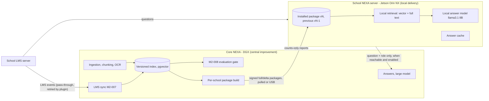

# NEXA-M2-009: School Edge Knowledge Cache & Offline Retrieval

Status: Implemented. Automated tests passing. School-server demonstration on the Pomnsoe Jetson: see section 10.
Milestone: M2
Principle: **central improvement, local delivery**
Aligns with: NEXA-M2-001 (metadata, access classes), M2-004 (index versioning), M2-005 (retrieval), M2-006 (grounding), M2-007 (LMS sync), M2-008 (evaluation), NEXA-GOV-001, ADR-0007 (NEXA Mini)

Implementation:
- `v1/edge/package.py`: package format, selection policy, build, signing.
- `v1/edge/edgestore.py`: read-only package store for the school server.
- `v1/edge/sync.py`: install, delta apply, pull, rollback.
- `v1/edge/web.py`: core package endpoints, delegation, school-node behaviour, answer cache.
- `v1/edge/cli.py`: build, school-key, install, pull, rollback, status.
- `v1/edge/deploy/`: installer and systemd units for a school server.

Tests: `v1/tests/test_edge.py`.

## 1. Roles



| | Core NEXA (DGX) | School NEXA server (Jetson) |
|---|---|---|
| Content | Ingests, governs, approves, indexes, evaluates | Never edits content; serves the installed package (read-only; content changes return 409) |
| Embeddings | Embeds every document | Embeds only the question (`nomic-embed-text`, the same model; checked at install) |
| Retrieval | Full corpus, all schools | Always local: the same hybrid retrieval, authority, outline and spelling code over its own package |
| Answers | Large model | Local `llama3.1:8b`. With `NEXA_EDGE_ANSWER_ROUTE=core_first`, the core writes the answer when reachable within 25 s, with local as fallback. Repeated questions come from the cache. |
| Needs the other to work | No | **No.** Normal retrieval and answers need no core or cloud connection. |

**Why it is split this way.** A Jetson Orin NX (16 GB) searches a school package in milliseconds. The expensive parts are kept off it: document embedding, OCR, index builds and evaluation all run on the core. Answer generation can go to the core when the link is up, and stays local when it is not.

**Deployed pairs today.** Each school has its LMS server and a NEXA server:
- Pomnsoe: `pomnsoe-school-server` and `pomnsoe-nexa-server` (10.20.50.11).
- Hutjena: `hutjena-school-server` and `hutjena-nexa-server`.

## 2. What is replicated to a school

A package holds the chunks of the active core index (text, metadata and float16 vector) that pass `select()` for that school:

| Content | In the school's package |
|---|---|
| Approved national (and provincial, for the school's province) curriculum | Yes |
| This school's own approved school and class content | Yes |
| Teacher-only material (teacher guides, teacher notes) | Yes by default, served to teacher roles only, enforced on the school server exactly as on the core. `--no-teacher-only` leaves it out. |
| Another school's content | **Never** |
| Restricted material (assessment keys) | **Never**: stays on the core |
| Unapproved, draft or withdrawn content | **Never** |
| Subjects, grades and languages the school does not teach | Optional exclusion by policy (`--subjects`, `--grades`, `--languages`) |
| Original files, the ingestion registry, LMS event logs | **Never**: only chunks travel |
| Learner data of any kind | **Never**. Packages are built from the curriculum index, which holds none. Every manifest states `contains_learner_data: false`, and the school server refuses a package that does not. |

**Size.** Measured on the M2-002 corpus: 1,801 chunks from 71 sources make a **5.2 MB** download (12.8 MB installed). A delta for two changed sources is **0.11 MB**. A school package is under 1 % of a Jetson's free disk.

## 3. Package, versions and integrity

Each school has its own version sequence (v1, v2, …), built on the core with `python -m v1.edge.cli build --school <id>`. A version contains:

- **`manifest.json`:**
  - the school, the version and when it was built;
  - the core index and embedding fingerprint;
  - the selection policy;
  - every source with the SHA-256 of its chunk set;
  - the file hashes;
  - counts of what was excluded and why;
  - probe vectors for the model check.
- **`manifest.sig`:** HMAC-SHA256 of the manifest with the school's sync key. Each school's key is derived from the core master key, so a school server holds only its own key and cannot forge another school's package.
- **The data:**
  - full: `knowledge.sqlite`, the chunks plus an FTS5 full-text index;
  - delta from the previous version: `delta.sqlite`, the changed and new sources and the withdrawn ones.

Both travel as one `.tar.gz`.

A school server installs a version only if every check passes. Otherwise it keeps serving what it has:

1. The signature is valid.
2. The package is for this school.
3. The version is newer than the installed one. A delta also requires the installed version to be its base.
4. File hashes match the manifest.
5. After the delta is applied, every source hash equals the manifest's target state, and no unlisted source remains.
6. The local embedding model reproduces the core's probe vectors (cosine ≥ 0.999). This guarantees question vectors and document vectors share one space.

   **When the same model is computed differently,** the school server re-embeds instead. This happens when the probe cosine is between 0.8 and 0.999, for example because the school runs a different Ollama version. Found on the Pomnsoe Jetson: Ollama 0.32.1 against 0.21.0 on the DGX, same model file `970aa74c…`, cosine 0.90. The school server then re-embeds the package's documents with its own model at install, using the exact text the core embedded (`embedding_text`, carried in the package), so questions and documents share one space. Content is still verified against the core's `content_sha256` (ids, text, metadata, embedding text). Only the vectors are local, recorded in `local.json` and the sync log. After a delta, only new and changed sources are re-embedded.

   **Below 0.8** it is a different model, and the package is refused. `NEXA_EDGE_REEMBED=false` turns re-embedding off.

**Install and rollback.** The new version is built beside the one being served. The switch is one atomic write of `current`, so the store picks it up on the next request without a restart. The previous version is kept for `rollback`.

## 4. Synchronisation

- **Pull, initiated by the school.** This works behind school NAT and firewalls.
  - With `NEXA_EDGE_CORE_URL` and an `edge_node` token, the school server checks every 30 minutes: `GET /v1/edge/packages/<school>/latest`.
  - If a newer version exists, it fetches `…/<version>/bundle?from=<installed>`. That is a delta when one exists from the installed version, else the full package.
  - The token only reaches its own school's packages.
- **File import** (`cli install <bundle>`). This is for schools with no usable link: scp, or a USB stick from the district office. It runs the same checks and gives the same result.
- **Bandwidth.**
  - Deltas carry only sources whose hash changed.
  - Vectors are float16.
  - Bundles are gzipped.
  - Policies can drop subjects and grades a school does not teach.
  - Nothing is re-sent for unchanged content.
- **Reports.** After each pull the school server posts counts only: the package version, answers by route (local, core, cache), statuses and cache hits. The core keeps only those fields.
- **Transport today.** The Pomnsoe Jetson is on the school tailnet and cannot reach the DGX, which is on the `learnx.ac.pg` tailnet. It does have internet access. The recommended production path is a Cloudflare named tunnel exposing only `/v1/edge/*` and `/v1/knowledge/answer` on the core to school servers, behind per-school `edge_node` tokens. Until then, packages move by file (section 10).

## 5. Offline retrieval

The school server runs the unchanged knowledge service with `NEXA_KNOWLEDGE_STORE=edge` and `NEXA_EDGE_MODE=true`, plus a local Model Gateway over its Ollama models. The following all run on the school server against its package:
- hybrid retrieval: exact cosine over vectors in memory, plus FTS5 BM25;
- near-copy removal;
- authority rules and conflict handling;
- evidence grading and grounded answers with citations;
- course outlines, spelling correction and labelled general answers.

**Search cost.** At corpus scale a vector search takes 0.7 ms and a full-text search 2.4 ms (x86 measurement; a Jetson is a few times slower and still far below the cost of the question embedding).

**Repeated questions.** A class asking the same thing is answered from an LRU cache (2,000 entries, 24 h). The cache key is (package version, role, school, normalised question), so a package switch never serves stale answers.

**No dependency on the core.** Retrieval, answers, the cache and access control need no core or cloud connection. Only pulling packages and the optional `core_first` answers do, and both degrade to "keep serving what is installed".

## 6. Separation of national, school and personal data

| Data | Where it lives | Leaves the school? |
|---|---|---|
| National curriculum | Core; a copy in every school package | Arrives from the core only |
| School-local approved content | Authored in the school's Moodle, governed and indexed on the core, in that school's package only | Goes to the core through LMS sync (M2-007); never reaches other schools |
| Teacher-only material | In the package, served to teacher roles only | No |
| Restricted (assessment) material | Core only | Never sent to schools |
| Learner data: identities, questions, answers, history | On the school server (and the school's LMS) only | **No.** A `core_first` answer request carries the question text and the asker's role (student or teacher), authenticated with the school server's own token, never the learner's identity. Reports carry counts only. |

**Core-side delegation.** The core treats a request from a school server (role `edge_node`, `X-NEXA-Act-As-Role`) as that role at that school and nothing more. It refuses any other role (403).

**On the school server.** Users are always that school's users: tokens without a school claim are scoped to the server's school, so the school's own content is visible to them, and other schools' content is never present.

**NEXA-GOV-001.** The document itself is not in the repository. These rules apply the controls NEXA already enforces: approval status, access classes, school scope, and no learner data in shared stores. They are to be checked against GOV-001's data-minimisation and retention sections when that document is supplied.

## 7. Conflict and update behaviour after reconnection

| Situation | Behaviour |
|---|---|
| School offline while the core published new versions | First successful pull installs the newest. Deltas exist only from the previous version, so a school several versions behind gets the full package (tested). |
| Content withdrawn on the core while the school was offline | Removed at the first install that announces it: the delta lists withdrawn sources, and a full package simply does not contain them. |
| New school content written in Moodle while offline | Stays in the Moodle plugin's outbox. The school server answers 503 with `Retry-After` while it cannot reach the core, then the plugin replays on reconnection. Event ids make replays idempotent, and the core's revision check rejects stale edits. The content reaches the school server in the next package, after core approval. |
| The school server and the core disagree on content | The core is the authority; the school server never edits content, so a package replaces its state completely. |
| Download interrupted, or a corrupted or altered bundle | Never installed: it fails the hash or signature check, the served version is unchanged, and the next pull retries. |
| Embedding model changed on the core, or differs on the school server | The package is refused until the school server runs the same model (probe check). The served version is unchanged. |
| A bad package installed | `cli rollback` switches back to the previous version at once. |
| Caches after a switch | Keyed by package version, so they are never served across versions. |
| Clock differences | Versions are integers set by the core; nothing depends on the school server's clock. |

## 8. Security

- The school server verifies its users' tokens with its own identity secret, generated at install and never shared with the core.
- The core issues each school server an `edge_node` token bound to its school.
- Package keys are per school.
- The school node is read-only. LMS endpoints are passed through to the core unchanged, and the core authenticates the LMS's own token.
- `/v1/edge/status` reports:
  - the package version and build date;
  - the sync history;
  - the routing mode;
  - the cache and route counts.

## 9. Operating a school server

```bash
# on core NEXA (DGX): build for a school, and give the school its sync key
python -m v1.edge.cli build --school pomnsoe
python -m v1.edge.cli school-key --school pomnsoe --out ~/pomnsoe-sync.key

# on the school server
sudo bash v1/edge/deploy/install.sh pomnsoe          # services, venv, settings (secrets generated locally)
python -m v1.edge.cli install nexa-edge-pomnsoe-v1-full.tar.gz
python -m v1.edge.cli status | pull | rollback
```

The installer leaves other software alone. The school's v0 `nexa.service` on port 8000 keeps running until the school is switched to the edge service on port 8103.

### 9.1 Classroom load

Answer generation is the slow step on a school server. A fair queue (`NEXA_GENERATION_CONCURRENCY`,
matched to Ollama's `OLLAMA_NUM_PARALLEL`) makes students wait their turn instead of all timing out;
identical questions asked together are generated once; repeats come from the answer cache; a queued
answer rides out a short Ollama restart (`NEXA_GENERATION_OUTAGE_WAIT_S`). On the Jetson, Ollama also needs
the lean memory settings, or a burst of 100 questions runs it out of memory. Measured on the Pomnsoe
Jetson: a class of 30 at once, or 100 students over a lesson, are all answered; a burst of 100 at the same
moment exceeds what one Jetson can write in 10 minutes (about 5–7 answers a minute). Evidence:
[m2-009-load-jetson-20261116.md](evidence/m2-009-load-jetson-20261116.md). Load test:
`sudo bash v1/edge/deploy/loadtest.sh` (refuses to run while edge.env holds the queue settings itself).

## 10. Acceptance criteria (NEXA-M2-009)

| Criterion | Status | Evidence |
|---|---|---|
| Edge knowledge package and sync model documented | **Met** | Sections 2–4 and 7 |
| Offline retrieval demonstrated with a representative curriculum subset | Tests: met (`test_offline_retrieval_matches_core`: identical rankings to the core; `test_school_node_answers_offline_and_caches_repeated_questions`). Jetson: pending | The Pomnsoe Jetson cannot reach the DGX at all, so any answer it gives is offline by construction. Evidence: the M2-008 live suite run against the Jetson. |
| Reconnect/update scenario tested | Tests: met (`test_pull_from_core_up_to_date_update_and_offline`, `test_delta_update_applies_changes_and_withdrawals`, `test_a_school_offline_for_several_releases_gets_a_full_package`, `test_tampered_wrong_school_old_or_wrong_model_packages_are_refused`). Jetson: pending | v1, then v2 delta with an added subject, then v3 delta with a withdrawal, installed on the Jetson; then rollback |
| No dependency on continuous DGX/cloud connectivity for normal local retrieval | **Met** by design and test; Jetson pending | Section 5; core URL unreachable in the tests |
| Data minimisation and access policies align with NEXA-GOV-001 | Met against the controls in the repository; to be confirmed against GOV-001 itself | Sections 2 and 6; `test_package_holds_only_what_this_school_may_have`, `test_core_first_sends_role_and_question_only`, `test_core_accepts_delegation_only_for_its_school_and_safe_roles` |

## 11. Open decisions

1. **Network path from school servers to the core.** A named Cloudflare tunnel on the core is recommended. A shared tailnet is the alternative.
2. **Default answer routing.** `local` keeps every question at the school. `core_first` gives better answers when the link is good. This is a policy choice per school.
3. **NEXA-GOV-001 review** of sections 2 and 6.
4. **Retiring v0 on the school servers.** The PDFs on the Jetson's v0 include Engineering and Technology documents that the core does not hold. They should be ingested on the core so they reach every school through packages.
